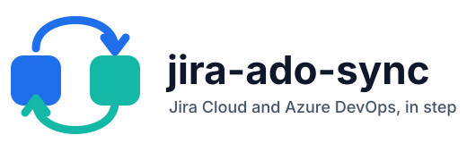
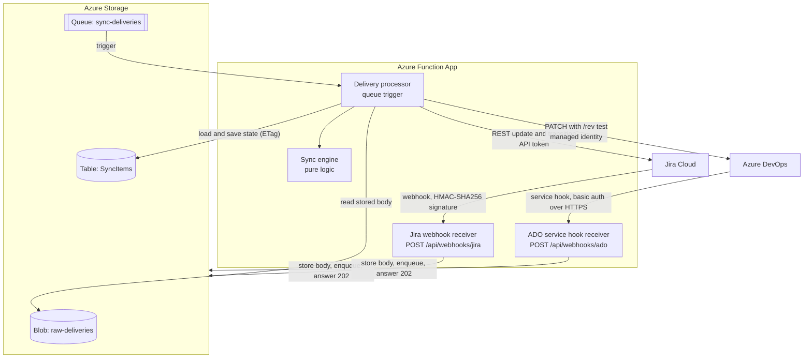

<p align="center">
  
</p>

<p align="center">
  <a href="https://github.com/miralem-cebic/jira-ado-sync/actions/workflows/ci.yml"></a>
  <a href="LICENSE"></a>
  
</p>

A configurable, bidirectional sync between **Jira Cloud** and **Azure DevOps** work items, built as an Azure Function.
Atlassian's built-in Azure DevOps connector only syncs in one direction. This project keeps both systems in step, so
that teams working in either tool see the same state.

> **Status:** Phase 1 (walking skeleton) is done in code and covered by tests. The Function runs locally against
> Azurite. Nothing is deployed to Azure, and nothing has run against a real Jira site or Azure DevOps organization yet.
> Phase 2 (real systems, sandbox, deployment) is next. The project is not production-ready. See the
> [roadmap](docs/roadmap.md).

## Architecture



Changes arrive by webhook, not by polling ([ADR 0003](docs/adr/0003-receive-changes-by-webhook.md)). The receivers only
authenticate, store the raw body and enqueue it ([ADR 0004](docs/adr/0004-acknowledge-and-enqueue-deliveries.md)), so
they answer quickly. The processor does the sync. Loop prevention (echo suppression and the hash check) and idempotent
processing are described in [docs/DESIGN.md](docs/DESIGN.md), sections 5 to 7.

## Goals

- Bidirectional sync of work items between Jira Cloud and Azure DevOps.
- Everything environment-specific is configuration, not code: sites, organizations, project mappings, status mappings,
  field selection, conflict policy.
- Safe to run against real data: loop prevention, idempotent processing, and a clear conflict policy.
- Deployable as an Azure Function, with infrastructure documented as an example.

## Non-goals (for now)

- Jira Data Center / Server.
- Attachments and custom field mapping (planned later, see the design doc).
- Syncing repositories, pipelines, or boards.

## Quick start: build and test

| Tool | Version | Used for |
|---|---|---|
| .NET SDK | the version in [global.json](global.json) (.NET 10) | build, tests, the Function |
| Node.js | 22 or later | Azurite and Azure Functions Core Tools, the baseline check |
| Python | 3 | the smoke and replay scripts (the replay script needs [scripts/requirements-replay.txt](scripts/requirements-replay.txt)) |

```bash
dotnet restore JiraAdoSync.slnx --locked-mode     # versions come from the lock files
dotnet build JiraAdoSync.slnx -c Release          # warnings are errors
dotnet test --solution JiraAdoSync.slnx -c Release
scripts/verify.sh                                 # the full gate, as CI runs it
```

`scripts/verify.sh` restores from the lock files, builds with every warning as an error, runs the tests and checks the
formatting. CI also runs ShellCheck on `scripts/*.sh`, a report of vulnerable packages, the Conventional Commit check of
pull request titles and the engineering-baseline conformance check in strict mode.

The storage tests run against Azurite only when `SYNC_TEST_STORAGE` is set. With Azurite running (see below):

```bash
SYNC_TEST_STORAGE="UseDevelopmentStorage=true" dotnet test --solution JiraAdoSync.slnx -c Release
```

## Run locally

The Function runs on the Azure Functions Core Tools with Azurite as storage. The full steps, with the local settings and
a signed example request, are in [docs/running-locally.md](docs/running-locally.md). In short:

```bash
npm install -g azurite@3 azure-functions-core-tools@4
azurite --skipApiVersionCheck --location ./azurite-data   # the flag is needed for the current Azure SDK
dotnet publish src/JiraAdoSync.Functions -c Release -o ./local-app
# add config.json and local.settings.json to ./local-app, see docs/running-locally.md
cd ./local-app && func start --port 7071
```

The host creates the blob container, the queue and the table at startup. If a required setting is missing, it stops and
names the setting, never its value.

## Configuration

Non-secret settings live in a JSON file. Start from [config/config.example.json](config/config.example.json), validate it
against [config/config.schema.json](config/config.schema.json), and place it next to the app (or point `SYNC_CONFIG_PATH`
at it). The loader rejects unknown properties and reports every error at once.

| Key | Meaning |
|---|---|
| `jira.siteUrl` | Jira Cloud site, e.g. `https://example.atlassian.net` |
| `jira.authMode` | `apiToken`, the only value for now |
| `jira.accountEmail` | Account of the dedicated Jira service account, used with its API token |
| `jira.serviceAccountId` | Account ID of that service account. Its own changes are not echoed back |
| `jira.apiTokenSetting` | Name of the app setting that holds the API token |
| `jira.webhookSecretSetting` | Name of the app setting that holds the webhook secret |
| `azureDevOps.organization` | Organization name, not the URL |
| `azureDevOps.authMode` | `managedIdentity` (recommended) or `pat` (local testing only) |
| `azureDevOps.patSetting` | Required with `pat`: name of the app setting that holds the PAT |
| `azureDevOps.serviceIdentity` | Identity the sync writes to Azure DevOps as. Its own changes are not echoed back |
| `azureDevOps.webhookUserSetting`, `azureDevOps.webhookPasswordSetting` | Names of the app settings with the basic-auth credentials of the service hook |
| `conflictPolicy` | `lastWriteWins` |
| `features` | `title`, `description`, `status`, `assignee`. Each defaults to `true` |
| `projectMappings[]` | `jiraProject`, `adoProject`, `areaPath` and a one-to-one `statusMap`. Unmapped statuses are not synced |

Secrets never go into this file. It names the setting that holds each secret, and the value comes from the app settings
or from Azure Key Vault.

The host reads these settings at startup: `AzureWebJobsStorage` (the storage connection string), the setting names
above, and the PAT setting when `authMode` is `pat`.

### Jira webhook

1. Create a dedicated Jira service account and an API token for it. Store the token in the setting named by
   `jira.apiTokenSetting`.
2. Create a webhook in Jira Cloud (Settings, System, WebHooks, or the REST API) for the events *Issue created* and
   *Issue updated*. The URL is `https://<function-app>.azurewebsites.net/api/webhooks/jira`.
3. Give the webhook a secret and store the same value in the setting named by `jira.webhookSecretSetting`. Jira signs each
   delivery with an HMAC-SHA256 in the `X-Hub-Signature: sha256=<hex>` header. The host compares it in constant time
   ([ADR 0006](docs/adr/0006-webhook-authentication.md)).

Webhooks registered through the REST API expire after 30 days, so they must be refreshed. The refresh and the question
of registering per project or globally are open items in the roadmap. The signature format has not been checked against a
real Jira site yet (Phase 2).

### Azure DevOps service hook

1. In each mapped Azure DevOps project, open *Project settings*, *Service hooks*, and create a subscription of type
   *Web Hooks*.
2. Choose the triggers *Work item created* and *Work item updated*.
3. Set the URL to `https://<function-app>.azurewebsites.net/api/webhooks/ado`, the authentication to *Basic*, and store
   the user and password in the settings named by `azureDevOps.webhookUserSetting` and
   `azureDevOps.webhookPasswordSetting`. Basic authentication must use HTTPS.

### Azure DevOps identity

With `managedIdentity`, the Function writes to Azure DevOps with its managed identity, through a bearer token for the
Azure DevOps resource. Add that identity to the organization and grant it work item permissions in each mapped project.
Set `azureDevOps.serviceIdentity` to the same identity, so its own changes are not echoed back.

A personal access token is supported only for local testing (`authMode: "pat"`).

### Linking items

The sync only touches items that have a row in the `SyncItems` table. Changes to other items are skipped as `NotLinked`.
Creating the item on the other side, and with it the row, is Phase 3. No tool writes these rows yet. A row needs the four
columns `AdoWorkItemId`, `LastSyncedHash`, `LastChangedAt` and `LastWriter`, and `LastSyncedHash` must be the hash of the
synced fields. That is not something to type in by hand. Decide how the first sandbox run creates its rows before Phase 2
starts (see [DESIGN.md](docs/DESIGN.md), section 4).

## Deployment

**Deployment is not automated yet.** Infrastructure as code for the reference deployment is a Phase 2 item. Nothing in this
repository has been deployed to Azure or checked there. The outline below states what the code expects.

| Resource | Notes |
|---|---|
| Resource group | One per environment |
| Storage account | Holds the blob container `raw-deliveries`, the queue `sync-deliveries` and the table `SyncItems`. The host creates these three at startup. The poison queue `sync-deliveries-poison` is created by the runtime when a message reaches it. The connection string goes into `AzureWebJobsStorage`. |
| Function App | Linux, .NET 10 isolated worker, Functions v4 runtime, HTTPS only |
| Managed identity | System-assigned on the Function App. Granted access to the Azure DevOps organization (see above) |
| Key Vault | Planned for the secret values. App settings can reference Key Vault secrets. |

Steps, as the code expects them:

1. Create the resources above with the Azure CLI, the portal or your own infrastructure as code.
2. Set the app settings: `AzureWebJobsStorage`, `FUNCTIONS_WORKER_RUNTIME` set to `dotnet-isolated`, and the setting names
   from your configuration with their values (or Key Vault references). The values stay out of the configuration file.
3. Publish the app and include `config.json` in the publish output. The file holds no secrets:

   ```bash
   dotnet publish src/JiraAdoSync.Functions -c Release -o ./publish
   cp /path/to/your/config.json ./publish/
   (cd ./publish && zip -r ../publish.zip .)
   az functionapp deployment source config-zip --resource-group <rg> --name <app> --src publish.zip
   ```

4. Point the Jira webhook and the Azure DevOps service hook at the two endpoints (see Configuration).
5. Check the deployment. Send an unsigned request to `https://<app>.azurewebsites.net/api/webhooks/jira`. It must be
   answered `401`, with the security headers present. Do not run the smoke script against the deployed host: it sends a
   signed delivery for `PROJ-1`.

The storage connection is read from `AzureWebJobsStorage` as a connection string. Access with the managed identity to
storage is not implemented yet.

## Operations

- **Logs.** The host writes one line when a delivery is answered and one when it is processed. Each line carries the
  source, the item, the blob name and the decision. Bodies and secrets are never logged.
- **Responses.** `202` when the delivery is stored and queued, `401` for a missing or wrong credential, `400` when the body
  is not JSON, `413` when the body is over 2 MiB ([ADR 0009](docs/adr/0009-maximum-webhook-body-size.md)), and `503` when
  the body or the message could not be written. Jira and Azure DevOps retry `503` ([ADR 0007](docs/adr/0007-webhook-receiver-status-codes.md)).
- **Retries.** The delivery queue retries a failed message for about ten attempts, one minute apart. A message that still
  fails moves to `sync-deliveries-poison` ([ADR 0010](docs/adr/0010-delivery-queue-retry-and-poison.md)).
- **Poison queue.** The runbook [docs/runbooks/poison-queue.md](docs/runbooks/poison-queue.md) describes how to find the
  cause first. The replay script moves messages back to the delivery queue. Run it as a dry run first:

  ```bash
  pip install -r scripts/requirements-replay.txt
  python3 scripts/replay-poison.py --connection-string "$AZURE_STORAGE_CONNECTION" --dry-run
  ```

- **Smoke script.** [scripts/smoke-local.py](scripts/smoke-local.py) checks the status codes and security headers of a
  local host. It sends signed deliveries, so it is for local runs only.

## Layout

| Path | Content |
|---|---|
| `src/JiraAdoSync.Core/` | Pure core: sync engine, configuration, webhook parsers and request builders, ports. No I/O. |
| `src/JiraAdoSync.Adapters/` | Jira and Azure DevOps REST clients, retry policy, authorization handlers |
| `src/JiraAdoSync.Azure/` | Storage adapters (Blob, Queue, Table) and webhook delivery handling |
| `src/JiraAdoSync.Functions/` | Azure Functions host: HTTP triggers, queue trigger, start-up configuration |
| `tests/` | Unit and integration tests (xUnit v3), one project per layer |
| `config/` | JSON Schema and example configuration |
| `scripts/` | `verify.sh` (the gate), `smoke-local.py`, `replay-poison.py`, `apply-repo-settings.sh` |
| `docs/` | [Design](docs/DESIGN.md), [roadmap](docs/roadmap.md), [running locally](docs/running-locally.md), [choosing what is synced](docs/jira-sync-button.md), [decisions](docs/adr/README.md), [runbooks](docs/runbooks/poison-queue.md), [dependencies](docs/dependencies.md) |

The working agreement (test first, invariants, definition of done) is in [CLAUDE.md](CLAUDE.md).

## Engineering baseline

The quality rules follow [engineering-baseline](https://github.com/miralem-cebic/engineering-baseline). [baseline.json](baseline.json)
sets the profile: ecosystem `csharp`, topology `hosted-db`, surface `api` (a webhook API without browser content, so the API
header rules apply instead of the static-site ones). CI runs the conformance check of release v0.2.0 in strict mode; locally:

```bash
npx github:miralem-cebic/engineering-baseline check
```

The repository settings (squash merges, branch protection, secret scanning) are applied with
[scripts/apply-repo-settings.sh](scripts/apply-repo-settings.sh):

```bash
scripts/apply-repo-settings.sh miralem-cebic/jira-ado-sync "verify,pr-title,conformance / check"
```

## Contributing

See [CONTRIBUTING.md](CONTRIBUTING.md) and the [Code of Conduct](CODE_OF_CONDUCT.md). Report security issues privately, see
[SECURITY.md](SECURITY.md). Changes are listed in [CHANGELOG.md](CHANGELOG.md).

## License

MIT. See [LICENSE](LICENSE).
